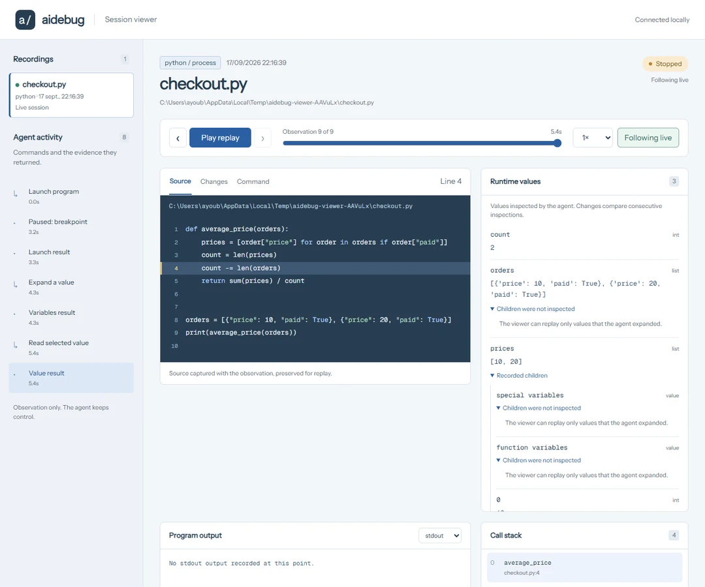

# aidebug

[](https://github.com/Boughzala-ayoub/aidebug/actions/workflows/checks.yml)

`aidebug` lets a coding agent debug local Python, JavaScript, TypeScript, and Rust programs through one deterministic JSON CLI. Run a program, stop at a breakpoint or failure, inspect runtime values, and step through the code before changing it. JavaScript and TypeScript support both Node.js and browser UI code.

<p align="center">
  
</p>

Each invocation connects to a persistent per-workspace background helper that owns the Debug Adapter Protocol (DAP) backend: `debugpy` for Python, Microsoft's `js-debug` for JavaScript/TypeScript (Node & browser), and `CodeLLDB` for Rust. A local Session Viewer streams the agent's debugging activity live and replays saved sessions afterward.

```sh
$ aidebug launch --run --breakpoint checkout.py:4 checkout.py
{"ok": true, "state": "stopped", "reason": "breakpoint", "location": {"file": "checkout.py", "line": 4}}
$ aidebug --fields 'locals.items[].name,locals.items[].value' inspect
{"ok": true, "locals": {"items": [{"name": "prices", "value": "[10, 20]"}, {"name": "count", "value": "2"}]}}
```

*(Design boundary: `aidebug` intentionally exposes structured DAP inspection and stepping rather than arbitrary expression evaluation or raw DAP passthrough.)*

`aidebug --help` is the agent usage reference. The bundled [skill](aidebug/skill/SKILL.md) tells agents when to use it. [AGENTS.md](AGENTS.md) contains contributor rules and [CHANGELOG.md](CHANGELOG.md) the release and verification history.

## Install

Python 3.10 or newer:

```sh
python -m venv .venv
# Windows
.venv\Scripts\python -m pip install .
.venv\Scripts\aidebug --help
# Linux/macOS
.venv/bin/python -m pip install .
.venv/bin/aidebug --help
```

Activate the environment or use the full executable path for the commands below. debugpy is the only Python runtime dependency. A regular install copies the package, so stop any session and reinstall after editing the debugger source.

| Language and target | Required tools | Adapter selection |
| --- | --- | --- |
| Python script or module | Python and installed debugpy | Included with `pip install .` |
| JavaScript or TypeScript on Node | Node.js and the standalone js-debug DAP server | `--adapter PATH/TO/dapDebugServer.js` or `AIDEBUG_JS_DEBUG` |
| JavaScript or TypeScript in a browser | The same Node/js-debug tools, Chrome, Chromium, or Edge, and your running local web server | Same JS adapter; optional `--browser EXE` |
| Rust executable | CodeLLDB with its bundled LLDB libraries; Rust to build your program with debug symbols | `--adapter PATH/TO/codelldb.exe` or `AIDEBUG_CODELLDB` |

Download the standalone DAP archive from [js-debug releases](https://github.com/microsoft/vscode-js-debug/releases). The tested archive is `js-debug-dap-v1.117.0.tar.gz`. Extract it under `.tools` so `.tools/js-debug/src/dapDebugServer.js` exists.

Download the matching platform archive from [CodeLLDB releases](https://github.com/vadimcn/codelldb/releases). The tested Windows archive is `codelldb-win32-x64.vsix` version 1.12.3, a ZIP file. Extract all of it under `.tools/codelldb`, keeping the `extension/adapter` and `extension/lldb` directories. The executable is `.tools/codelldb/extension/adapter/codelldb.exe` on Windows and `codelldb` elsewhere.

`.tools` paths are relative to the selected workspace and ignored by Git. Use an environment variable or `--adapter` for a shared installation; `doctor --help` has the details. aidebug never downloads adapters, compiles code, starts a web server, or runs package scripts. Missing tools return a JSON `missing_dependency` error that names the attempted path before a session starts. `doctor` runs the same path checks without launching anything; it does not validate adapter startup.

### Agent skill

Register the bundled skill for Codex and Claude Code:

```sh
aidebug skills install --agent codex --agent claude-code
aidebug skills status
```

The default user scope copies the skill and its language references into `~/.agents/skills/aidebug` and `~/.claude/skills/aidebug`. Invoke it explicitly with `$aidebug` in Codex or `/aidebug` in Claude Code; start a new agent session if it is not listed. Discovery does not guarantee a model picks it for every bug. For one project, add `--scope project` (paths are relative to `--workspace`).

Installation is explicit: `pip install` does not edit agent configuration, and setup leaves `AGENTS.md` and `CLAUDE.md` alone. The generated `installation.json` records file hashes, the package version, and a machine-specific interpreter command the skill can use if `aidebug` is absent from PATH. For shared repositories, prefer user scope or ignore the generated project skill directories.

Run `skills install` again after upgrading or moving the CLI; a current install is a no-op. Status reports `not_installed`, `current`, `outdated`, or `conflict`. Modified, missing, or unmanaged skill files cause a JSON error. Installation refuses directory links and junctions. `skills uninstall` with the same agents and scope removes only unchanged managed files. The format follows the [Codex skills](https://learn.chatgpt.com/docs/build-skills), [Claude Code skills](https://code.claude.com/docs/en/skills), and [Agent Skills](https://agentskills.io/specification) documentation.

## Debug a program

Start with the smallest relevant test. Use aidebug when a runtime value, branch, caller, closure, or state transition remains uncertain. From the repository root:

```sh
aidebug launch examples/walk.py "hello world"
aidebug break set examples/walk.py 12
aidebug continue
aidebug inspect
# Copy the handle for nested from locals.items into the next command.
aidebug variables HANDLE
aidebug step into
aidebug step over
aidebug step out
aidebug break remove examples/walk.py
aidebug continue
aidebug output
aidebug stop
```

At line 12, `known` is `41`. Stepping into `add_one` exposes its `value` argument. Stepping over the addition produces `answer = 42`.

| Command | Behavior |
| --- | --- |
| `launch [OPTIONS] TARGET [ARGS...]` | Launch a script, executable, local browser URL, or Python module with `--module`. Process targets stop at entry unless `--run` is present. Use a launch breakpoint for a browser. |
| `break set FILE LINE [LINE...] [--condition EXPR]` | Add or update breakpoints. Omitting the condition clears it on the supplied lines. Report requested and actual lines, condition, and verification result. |
| `break remove FILE [LINE...]` | Remove the given lines, or all breakpoints for the file when no lines are supplied. |
| `exceptions on` / `exceptions off` | Toggle uncaught Python/JS exceptions or Rust panics. Default is off unless launch includes `--uncaught`. Rust also stops on panics that the application later catches. |
| `continue` | Resume until a stop, exit, failure, or deadline. |
| `pause` | Request a stop in a configured running target and wait until stopped, exited, terminated, failed, or timed out. |
| `step into` / `step over` / `step out` | Step in the thread that triggered the current stop. |
| `inspect [--frame HANDLE] [--limit N]` | Return the stack, selected source location, locals, and scope handles. Default frame is the top frame. |
| `scopes [--frame HANDLE]` | List all adapter-provided scopes for the frame without expanding them. |
| `value --scope HANDLE [PATH] [--key NAME ...]` | Select nested children by name without evaluating expressions. |
| `variables HANDLE [--start N] [--limit N]` | Expand children of a value or scope. |
| `wait` | Wait for stopped, exited, terminated, or failed state; permits other commands and supports `--timeout` up to 3,600 seconds. |
| `sources [--filter TEXT] [--start N] [--limit N]` | List loaded sources and current breakpoint bindings. |
| `automation` | Get private page CDP access and the installed Puppeteer helper. |
| `doctor [--language LANGUAGE] [--target TARGET]` | Validate local launch dependencies without starting a session. |
| `status` | Report state. Include inspection when stopped. |
| `output` | Read separate bounded stdout, stderr, and adapter diagnostic buffers without clearing them. |
| `stop` | Disconnect, terminate owned processes, remove session metadata, and exit the helper. Safe to repeat. |
| `note TEXT` | Add an explicit agent explanation and capture edits to previously inspected source files. |
| `view [--open]` / `view --stop` | Start, locate, or stop the local viewer. |
| `recordings prune --older-than DAYS [--dry-run]` | Preview or remove old recordings after stopping the workspace's debug session. |

Global options go before the command:

```sh
aidebug --workspace /path/to/project --timeout 2 continue
aidebug --workspace /path/to/project launch --cwd tests --python /path/to/python script.py --flag value
```

The workspace defaults to the current directory. Script, breakpoint, adapter, working-directory, and explicit relative interpreter paths resolve relative to it. Use the same `--workspace` on later invocations. Launch options must precede the target name; target arguments follow it.

Launch options common to the adapters are `--language`, `--cwd`, `--run`, `--no-wait`, `--uncaught`, `--no-record`, repeatable `--breakpoint FILE:LINE`, and `--condition EXPR`. Python also accepts `--python EXE` and `--module`. JS/TS accepts `--target node|browser`, `--node EXE`, and repeatable `--out-files GLOB`. Browser launches also accept `--browser EXE`, `--web-root DIR`, `--headed`, `--disable-gpu`, and repeatable `--url-path URL_PATH=LOCAL_FILE`. Rust requires `--language rust`; the other languages are inferred from source extensions, and `--module` infers Python. `launch --help` has examples verified through Windows PowerShell 5.1.

### Inspect values

`inspect` returns every scope reported by the adapter, capped at 30, alongside the locals. `scopes --frame HANDLE` selects a caller. Expensive scopes are listed without being expanded; use their handles with `variables` or `value`.

`value` follows DAP variable children by dot-separated name. Repeated `--key` arguments select exact names, including dictionary keys containing dots: `value --scope HANDLE --key settings --key "network.timeout"`. Python string keys can omit debugpy's display quotes. Nothing is evaluated. A missing child returns an error naming the parent handle to expand with `variables`; adapters can omit inherited properties and getters.

Stack entries keep the adapter's `hint`. Labels have a null handle. Historical JavaScript frames after an async boundary have `async: true` and `scopes_available: false`, and selecting one returns `frame_not_inspectable`.

Put global `--fields` before the command to reduce stdout:

```sh
aidebug --fields state,reason,timed_out wait
aidebug --fields 'breakpoints[].line,breakpoints[].verified' break set app.py 12
aidebug --fields 'stack.frames[].name,stack.frames[].line,stack.frames[].handle' inspect
aidebug --fields value.value value --scope HANDLE settings.timeout
```

Paths are complete and comma-separated, with `[]` for array elements. The output keeps its JSON structure, missing fields become `null`, and each projected object keeps its `ok`, `error`, truncation, and `next_start` fields. At most 32 paths, eight levels, and 2,048 characters; overlapping paths are rejected before the command runs. Projection changes only CLI output, not recordings. aidebug's JSON is ASCII-safe; if a Python consumer on Windows raises `UnicodeEncodeError` printing decoded values, set `PYTHONIOENCODING=utf-8`.

### Wait, pause, and exits

`launch --no-wait` returns `outcome: started` while setup proceeds. `wait` accepts deadlines up to 3,600 seconds and returns on a stop or terminal state without expanding frames; use `inspect` after a stop. Only one wait runs at a time; another returns `busy`, so `status`, `pause`, and `stop` stay available.

```sh
aidebug launch --run --no-wait --breakpoint app.py:24 app.py
aidebug --timeout 300 wait
aidebug --timeout 2 pause
aidebug inspect
aidebug stop
```

Pause selects the previously stopped thread if it still exists, otherwise the adapter's first thread. A blocked native call can delay the stop, and an idle browser can defer it until its next JavaScript task. On a deadline the response reports the current state with `timed_out: true`.

A `terminated` adapter event without an `exited` event produces `state: terminated` and `target_exit_confirmed: false`: debugging ended and the program's exit is unknown. js-debug reports this even for some normal Node completions. Terminal responses include recent events, the adapter's exit code, transport errors, and the output tail. `ok` reports debugger command success, not target success; for an unknown exit, run a safe, repeatable reproduction outside the debugger. The [Node exit investigation](checks/agent-workflows.md) records the js-debug behavior.

### Conditional breakpoints

```sh
aidebug launch --run --breakpoint worker.py:12 --condition "i == 437" worker.py
aidebug break set worker.py 12 --condition "i == 439"
aidebug continue
aidebug break set worker.py 12   # no condition: unconditional again
aidebug stop
```

At launch, one `--condition` applies to every `--breakpoint`. Conditions are 1 to 512 characters, require adapter support, and use the adapter's expression language; Rust follows [CodeLLDB's rules](https://github.com/vadimcn/codelldb/blob/master/MANUAL.md#conditional-breakpoints). They execute code in the target and can have side effects. An expression error can make an adapter stop instead of skipping. A native source line can map to several locations, so Rust's `println!` can stop more than once per iteration.

## Languages and targets

### Python projects and tests

`--module` runs the target as a module, like `python -m`:

```sh
aidebug --workspace PATH/TO/PROJECT launch --module --run --breakpoint pricing.py:6 pytest -- -q test_checkout.py
aidebug --workspace PATH/TO/PROJECT inspect
aidebug --workspace PATH/TO/PROJECT continue
aidebug --workspace PATH/TO/PROJECT stop
```

Install pytest in the target environment first; unittest needs nothing extra (`--module unittest -- -q test_checkout`). The target interpreter resolves the module from `--cwd`; project code is never imported into the CLI or helper.

Interpreter selection is `--python`, then `VIRTUAL_ENV`, then the workspace `.venv`, then aidebug's own interpreter. `VIRTUAL_ENV` is skipped when it is aidebug's own environment, so activating the tool does not override the project. An invalid activated environment returns an error rather than falling through. Responses include the selected `python` path.

Test runners catch assertion failures, so set a breakpoint on the assertion or the function it calls. `--uncaught` can only stop at the runner's final `SystemExit`, after the failing test's locals are gone. The [checkout fixture](examples/project/test_checkout.py) computes 10 instead of 15 because `pricing.py` counts all orders after `orders.py` filtered unpaid ones.

### Node.js and TypeScript

```sh
aidebug launch --run --breakpoint examples/javascript/walk.js:8 examples/javascript/walk.js "hello world"
tsc examples/typescript/walk.ts --sourceMap --inlineSources --target ES2020 --outDir .tools/ts-demo
aidebug launch --language typescript --out-files ".tools/ts-demo/**/*.js" --run --breakpoint examples/typescript/walk.ts:8 .tools/ts-demo/walk.js
```

Stops are reported in the original `.ts` file. Build with source maps that match the current source first.

### Browser UI

Start your development server separately and launch its localhost URL:

```sh
aidebug --timeout 2 launch --language typescript --target browser --headed --web-root . --breakpoint src/save.ts:12 http://localhost:5173
# Click Save in the launched browser, then inspect from a separate CLI invocation.
aidebug inspect
aidebug stop
```

Launch is headless unless `--headed` is given. Each session uses a fresh Chrome profile in the system temporary directory, outside the workspace so dev-server file watchers never touch it, and `stop` removes it. `aidebug automation` gives a Puppeteer script private CDP access to the launched page for clicks and screenshots. [The JavaScript reference](aidebug/skill/references/javascript.md) covers automation, source mapping with `--web-root` and `--url-path`, and timing caveats.

### Rust

```sh
rustc -g -C opt-level=0 examples/rust/walk.rs -o .tools/rust-walk.exe
aidebug launch --language rust --run --breakpoint examples/rust/walk.rs:10 .tools/rust-walk.exe
```

For Cargo projects, run `cargo build` and launch `target/debug/YOUR_BINARY`. Optimized or stripped binaries can omit locals and move source locations. Entry stops can be in native startup code, so prefer launch breakpoints. Panic stops can be inside the Rust runtime and CodeLLDB reports them as `reason: breakpoint`; select your caller with `inspect --frame HANDLE`.

## Watch live or replay

```sh
aidebug view --open
```

This starts a hidden local server and opens the viewer; without `--open` it returns the URL as JSON. It follows the workspace's live session and lists saved recordings, even when opened before the session starts. It shows an activity timeline, source with the current line, inspected locals and expansions, the call stack, output channels, agent notes, and a **Changes** view of edits to inspected files. It shows only evidence the agent already recorded and never queries the debugger, so opening or replaying cannot resume or modify the target. `view --stop` stops only the viewer.

`aidebug note "TEXT"` records up to 4,000 characters of explanation during a session. The viewer does not infer the agent's reasoning or capture unrelated shell commands.

To see it without an agent, run the scripted demo, which records a diagnosis, a one-line fix, and a successful rerun:

```sh
.venv/Scripts/python checks/demo.py --cli .venv/Scripts/aidebug.exe --open
```

### Recordings

Recording is on by default. `launch --no-record` disables it for a session: no file, no viewer activity, and `note` is rejected. Recordings live in `.aidebug/recordings/SESSION_ID.jsonl` and contain command arguments, source, output, inspected values, and notes. They can include secrets from your program, are ignored by Git, and are never uploaded.

Each recording is capped at 32 MiB, an observation at 128 KiB, source snapshots at 24,000 characters, and output chunks at 8,192 characters. A full recording stops collecting without stopping the session, and write errors appear under `recording.error`. A helper crash leaves a partial recording shown as interrupted.

```sh
aidebug recordings prune --older-than 30 --dry-run
aidebug recordings prune --older-than 30
```

Pruning applies to the selected workspace, requires no live session, and preserves unrelated files, links, and malformed recordings. It stops at the first filesystem error and reports what it already deleted. There is no automatic retention.

## Output contract

All commands, including help and argument errors, print one JSON object to stdout. Target output never shares that stream. Command errors exit with code 1; successful debugger operations exit 0, including observing a target that failed. Check `exit_code` for the target's result; it is `null` when the adapter reports none.

A stopped response, with illustrative handles:

```json
{
  "ok": true,
  "state": "stopped",
  "reason": "breakpoint",
  "session": "a719...",
  "generation": 3,
  "timed_out": false,
  "location": {
    "file": "/project/examples/walk.py",
    "line": 12,
    "frame": "a719...:3:f:8",
    "source": [{"line": 12, "text": "result = add_one(known)", "truncated": false}]
  },
  "stack": {"frames": [], "truncated": false},
  "locals": {
    "handle": "a719...:3:v:9",
    "items": [
      {"name": "known", "type": "int", "value": "41", "handle": null, "truncated": false},
      {"name": "nested", "type": "dict", "value": "{'items': [3, 5, 8], 'label': 'test'}", "handle": "a719...:3:v:12", "truncated": false}
    ],
    "start": 0,
    "next_start": null,
    "truncated": false
  }
}
```

Values are debugger display strings. A non-null handle can be expanded with `variables`. Handles belong to one session and one stopped generation, and all expire when execution resumes.

States are `stopped`, `running`, `exited`, `terminated`, and `failed`. `running` with `phase: initializing` means setup is in progress. `failed` is an adapter or launch failure; an uncaught target exception is `stopped` with `reason: exception`, and a nonzero exit is still `exited`. `unknown` appears on client-side errors when the state could not be read.

Errors carry a stable `code` and a readable `message`: `invalid_request`, `invalid_state`, `invalid_handle`, `no_session`, `session_exists`, `busy`, `timeout`, `adapter_failure`, `control_failure`, `cleanup_failure`, and others. Adapter failures keep the adapter's structured explanation and `adapter_error_id` when supplied.

The command deadline defaults to 10 seconds and accepts 0.01 to 60, or up to 3,600 for `wait`. Launch, continue, step, and pause wait for the next stop or terminal state; on the deadline they return `timed_out: true` and leave the session alive. `inspection_truncated: true` means there was no time left to inspect a new stop. Helper startup can add up to five seconds. Adapter initialization has a 30-second ceiling, after which the session becomes `failed` and remains stoppable.

Responses are capped at 64 KiB. Inspection returns at most 20 frames, five source lines, and 20 variables by default; `--limit` accepts 1 to 30. Previews stop at 512 characters and source lines at 240. `truncated` marks shortened previews, omitted items, or a section dropped to fit the cap; use `next_start` for the next page. Each output channel keeps its last 8,192 characters and reports `dropped_chars` until `stop`.

## Security and processes

The control socket binds only to `127.0.0.1` and requires a random 256-bit token stored in `.aidebug/session.json`. The session directory has a user-only Windows DACL or POSIX mode `0700`. An OS file lock enforces one helper per workspace, and stale metadata is removed only under that lock. Processes running as your own user can read the token; this is not isolation from your own account or from the target.

The viewer binds to `127.0.0.1`, checks host and origin, and requires its own token, passed in the URL fragment and kept in that tab's session storage. Assets are bundled; the page makes no external requests.

Windows launches use `CREATE_NO_WINDOW`, and an owned Job Object terminates adapter descendants when the helper closes or dies. POSIX cleanup kills the adapter's process group. debugpy uses stdio; js-debug uses a random named pipe on Windows or a socket in the session directory on POSIX, with a child DAP connection per launched Node process or page; CodeLLDB connects back to a one-shot token-authenticated loopback listener. If an OS file lock outlasts the cleanup grace period, `stop` returns `cleanup_failure` and keeps session metadata for a retry. A helper crash can leave an `aidebug-browser-*` profile in the temporary directory.

## Limits

aidebug supports one local target and the thread that caused the stop. It has no stdin or interactive terminal support, expression evaluation command, variable mutation, remote attachment, worker or subprocess debugging, concurrent sessions per workspace, or thread selection. Additional js-debug child targets are rejected. Commands are serialized except `wait`; overlapping commands get `busy`.

Expression evaluation is left out because it can run arbitrary application code and change the state under investigation. Conditional breakpoints are the explicit opt-in exception. Inspection uses only DAP stack, scopes, and variable requests, though object formatting can still run representation or property code. Adapters materialize children before the CLI pages them, so response limits do not bound debuggee memory or CPU. The DAP transport rejects messages over 16 MiB. There is no profiling, layout inspection, or network tracing.

Killing a POSIX helper with `SIGKILL`, or a target escaping its process group, can leave descendants behind. Windows is verified for every adapter; Ubuntu WSL for the Python CLI, transport, and recording checks. Other combinations are unverified.

## Development

```text
aidebug/
  cli.py                 JSON commands, protected workspace helper and control channel
  launch.py              Validate and normalize explicit launch choices
  dap.py                 DAP framing, response matching, transports and owned processes
  session.py             State, deadlines, breakpoints, handles and bounded inspection
  recording.py           Bounded, persistent command/event/source observations
  viewer.py              Protected local HTTP server for saved observations
  automation.mjs         Puppeteer transport over js-debug's page CDP proxy
  skill/                 Bundled agent skill and language references
  web/                   Packaged viewer HTML, CSS, JavaScript, fonts and licenses
  adapters/              Static language-to-module mapping and per-adapter settings
checks/                  Installed-CLI checks; summaries in *-results.json
examples/                Fixtures used by the checks and the examples above
```

A new language starts with an adapter module and explicit launch validation. Shared state, inspection, bounds, and cleanup stay in the core. The registry is static; there is no plugin loader.

Every check runs against the installed executable in temporary workspaces, with real adapters and no test framework. Windows paths are shown; use `.venv/bin` on POSIX.

| Check | Command | Needs |
| --- | --- | --- |
| DAP transport and framing | `.venv/Scripts/python -I checks/transport.py` | |
| Recording, opt-out, pruning | `.venv/Scripts/python -I checks/recording.py` | |
| Python integration | `.venv/Scripts/python checks/integration.py --cli .venv/Scripts/aidebug.exe` | |
| Scopes, `--fields`, waits | `.venv/Scripts/python checks/experience.py --cli .venv/Scripts/aidebug.exe` | |
| Module launch and test investigation | `.venv/Scripts/python checks/project.py --cli .venv/Scripts/aidebug.exe --pytest-python .venv/Scripts/python.exe` | pytest (omit the flag to skip it) |
| Skill install and removal | `.venv/Scripts/python checks/skills.py --cli .venv/Scripts/aidebug.exe` | |
| PowerShell 5.1 help examples | `.venv/Scripts/python checks/powershell.py --cli .venv/Scripts/aidebug.exe` | Windows |
| Node, TypeScript, browser, Rust | `.venv/Scripts/python checks/multilanguage.py --cli .venv/Scripts/aidebug.exe --typescript-compiler PATH/typescript.js` | adapters, Node, Rust, Chrome |
| Node exits and state trial | `.venv/Scripts/python checks/node_workflows.py --cli .venv/Scripts/aidebug.exe` | js-debug |
| Browser automation and async frames | `node checks/browser_experience.mjs --cli .venv/Scripts/aidebug.exe --adapter .tools/js-debug/src/dapDebugServer.js --puppeteer .tools/viewer-check/node_modules/puppeteer-core` | Node 22+, puppeteer-core |
| Viewer at every width | `node checks/viewer.mjs --cli .venv/Scripts/aidebug.exe --puppeteer .tools/viewer-check/node_modules/puppeteer-core` | puppeteer-core |
| Average calculation example | `python checks/test_buggy.py` | |
| Summary stability | `python checks/reports.py` | |

Install the Node test dependencies separately from the package: `npm install --prefix .tools/viewer-check --no-save --package-lock=false puppeteer-core`, and the same with `typescript` under `.tools/ts-compiler` if your project has no compiler. The multi-language check accepts `--js-adapter` and `--rust-adapter` for shared installations; the viewer check accepts `--browser EXE`.

Tracked `checks/*results.json` files hold counts, check groups, and tool versions. Full reports, transcripts, timings, and screenshots go under the ignored `checks/artifacts/`.

[GitHub Actions](.github/workflows/checks.yml) runs the Python checks on Ubuntu, Windows, and macOS with Python 3.10 and 3.13, and a Windows job for the multi-language, Node workflow, browser automation, and viewer checks with pinned adapter versions. Hosted results are separate from the local summaries.

Protocol references: [debugpy](https://github.com/microsoft/debugpy) and its [launch settings](https://github.com/microsoft/debugpy/wiki/Debug-configuration-settings), the [DAP specification](https://github.com/microsoft/debug-adapter-protocol/blob/main/specification.md), [js-debug](https://github.com/microsoft/vscode-js-debug) and its [launch settings](https://github.com/microsoft/vscode-js-debug/blob/main/OPTIONS.md), and the [CodeLLDB manual](https://github.com/vadimcn/codelldb/blob/master/MANUAL.md).
